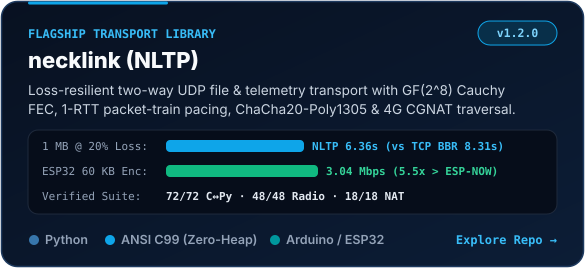
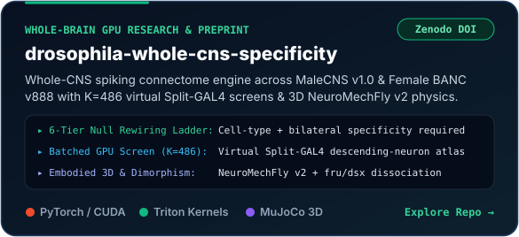
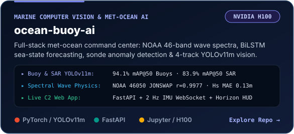
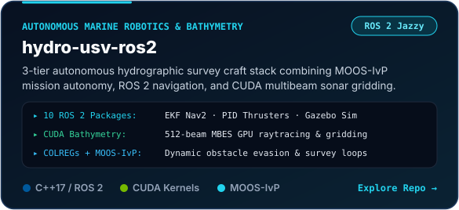
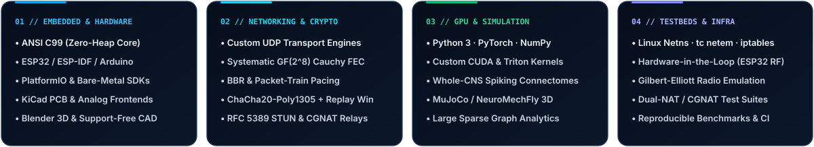

  

   

  

    
    
    
    
  

---

### Flagship Open-Source & Research

  
  

  
  

---

### Engineering Stack & Focus Areas

  

---

### Open-Source Portfolio, Releases & Live Web Demos

| Repository | Domain & Highlights | Stack / Live Access |
| :--- | :--- | :--- |
| **[necklink](https://github.com/indian-aman/necklink)** | Bidirectional loss-resilient UDP file & telemetry transport (`GF(2^8)` Cauchy FEC, 1-RTT packet-train pacing, `ChaCha20-Poly1305`, 4G CGNAT traversal) | `Python` · `ANSI C99` · `ESP32` · [**Release `v1.2.0`**](https://github.com/indian-aman/necklink/releases/tag/v1.2.0) |
| **[drosophila-whole-cns-specificity](https://github.com/indian-aman/drosophila-whole-cns-specificity)** | Whole-brain + VNC spiking connectome engine across MaleCNS v1.0 & Female BANC v888, `K=486` virtual Split-GAL4 screens & NeuroMechFly v2 3D physics | `PyTorch` · `CUDA / Triton` · `MuJoCo` · [**Zenodo DOI**](https://doi.org/10.5281/zenodo.23881805) |
| **[malecns-superfly-lab](https://github.com/indian-aman/malecns-superfly-lab)** | Interactive 3D Connectome Observatory, 10-Brain Super-Fly (`1.67M` spiking neurons, `12.5M` plastic synapses) & Allocentric Cognitive Map | `FastAPI` · `NumPy / SciPy` · `WebGL` |
| **[ocean-buoy-ai](https://github.com/indian-aman/ocean-buoy-ai)** | Smart Ocean Buoy AI Command Center: NOAA `46050` spectral wave physics, BiLSTM+Attention sea-state forecasting, sonde anomaly detection & 4-track `YOLOv11m` vision | `PyTorch` · `YOLOv11m` · `FastAPI` · `H100` |
| **[hydro-usv-ros2](https://github.com/indian-aman/hydro-usv-ros2)** | 10-package autonomous hydrographic survey craft stack with MOOS-IvP autonomy, ROS 2 Nav2 EKF, Gazebo Sim & CUDA 512-beam multibeam sonar gridding | `C++17` · `ROS 2 Jazzy` · `CUDA` · [**Architecture Diagrams**](https://github.com/indian-aman/hydro-usv-architecture) |
| **[moos-ros2-usv-sim](https://github.com/indian-aman/moos-ros2-usv-sim)** | **Mariner** — Bidirectional MOOS-IvP ↔ ROS 2 C++ bridge paired with a standalone 60 FPS browser-based USV obstacle-avoidance & CPA simulator | `C++` · `ROS 2` · `JS Canvas` · [**Live Web Sim**](https://indian-aman.github.io/moos-ros2-usv-sim/) |
| **[airwatch-aqms](https://github.com/indian-aman/airwatch-aqms)** | Real-time gas telemetry dashboard & Alphasense electrochemical/PID calibration engine (`H2S-B4`, `NH3-B1+`, `PIDX-A-040`) with stuck-channel fault detection | `Python` · `FastAPI` · `uPlot` · [**Live Dashboard**](https://indian-aman.github.io/airwatch-aqms/) |
| **[alphasense-aqms-datasets](https://github.com/indian-aman/alphasense-aqms-datasets)** | Historical field datasets, synthetic raw bipolar ADC fixtures, AAN 803-05 conversion formulas & reference datasheets for `H2S-B4`, `NH3-B1` & `PIDX-A-040` | `Python` · `JavaScript` · `CSV Datasets` |
