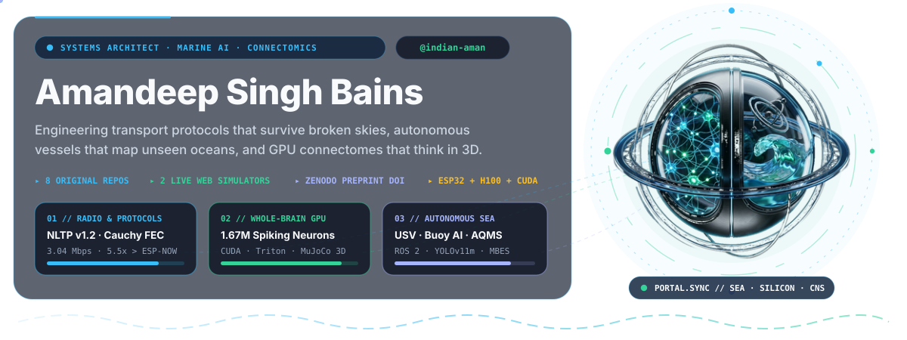
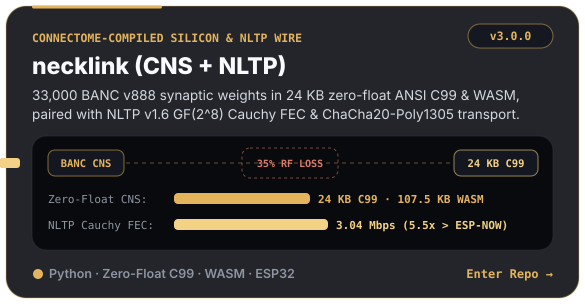
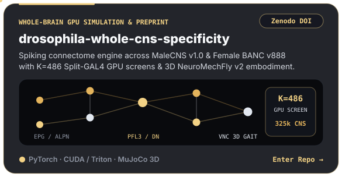
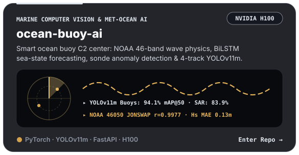
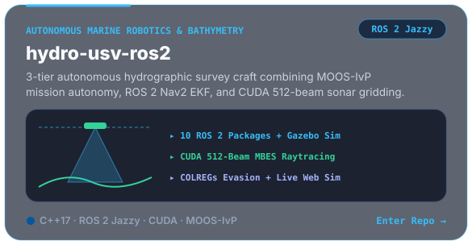
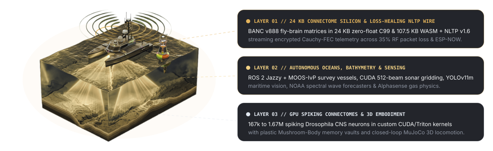
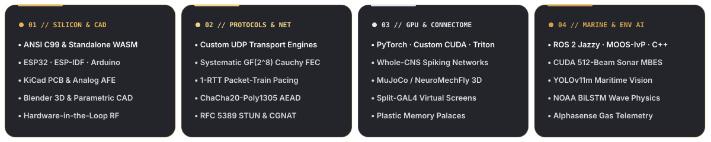
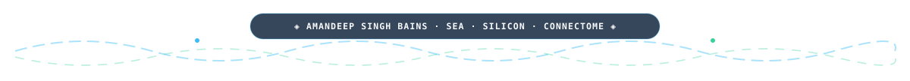

  <a href="https://github.com/indian-aman"><picture><source media="(prefers-color-scheme: dark)" srcset="assets/hero-dark.svg" /><source media="(prefers-color-scheme: light)" srcset="assets/hero-light.svg" /></picture></a>

  

    
    
    
    
    
  

  <picture><source media="(prefers-color-scheme: dark)" srcset="assets/divider-beam-dark.svg" /><source media="(prefers-color-scheme: light)" srcset="assets/divider-beam-light.svg" /></picture>

<h3 align="center">◈ Flagship Systems, Ocean Autonomy &amp; Whole-Brain Research</h3>

  <a href="https://github.com/indian-aman/necklink"><picture><source media="(prefers-color-scheme: dark)" srcset="assets/card-necklink-dark.svg" /><source media="(prefers-color-scheme: light)" srcset="assets/card-necklink-light.svg" /></picture></a>
  <a href="https://github.com/indian-aman/drosophila-whole-cns-specificity"><picture><source media="(prefers-color-scheme: dark)" srcset="assets/card-connectome-dark.svg" /><source media="(prefers-color-scheme: light)" srcset="assets/card-connectome-light.svg" /></picture></a>

  <a href="https://github.com/indian-aman/ocean-buoy-ai"><picture><source media="(prefers-color-scheme: dark)" srcset="assets/card-ocean-buoy-dark.svg" /><source media="(prefers-color-scheme: light)" srcset="assets/card-ocean-buoy-light.svg" /></picture></a>
  <a href="https://github.com/indian-aman/hydro-usv-ros2"><picture><source media="(prefers-color-scheme: dark)" srcset="assets/card-hydro-usv-dark.svg" /><source media="(prefers-color-scheme: light)" srcset="assets/card-hydro-usv-light.svg" /></picture></a>

  <picture><source media="(prefers-color-scheme: dark)" srcset="assets/divider-beam-dark.svg" /><source media="(prefers-color-scheme: light)" srcset="assets/divider-beam-light.svg" /></picture>

<h3 align="center">◈ Three Worlds, One Unified Stack — Sea · Silicon · Connectome</h3>

  <picture><source media="(prefers-color-scheme: dark)" srcset="assets/world-diorama-dark.svg" /><source media="(prefers-color-scheme: light)" srcset="assets/world-diorama-light.svg" /></picture>

  <picture><source media="(prefers-color-scheme: dark)" srcset="assets/divider-beam-dark.svg" /><source media="(prefers-color-scheme: light)" srcset="assets/divider-beam-light.svg" /></picture>

<h3 align="center">◈ Engineering Arsenal</h3>

  <picture><source media="(prefers-color-scheme: dark)" srcset="assets/arsenal-dark.svg" /><source media="(prefers-color-scheme: light)" srcset="assets/arsenal-light.svg" /></picture>

  <picture><source media="(prefers-color-scheme: dark)" srcset="assets/divider-beam-dark.svg" /><source media="(prefers-color-scheme: light)" srcset="assets/divider-beam-light.svg" /></picture>

<h3 align="center">◈ Complete Mission Index &amp; Live Browser Portals</h3>

| System / Expedition | Capabilities & Verified Benchmarks | Stack & Live Portal |
| :--- | :--- | :--- |
| **[NLTP (`pynltp`)](https://indian-aman.github.io/necklink/nltp/)** | Loss-healing `GF(2^8)` Cauchy FEC, 1-RTT `X25519` forward-secret `ChaCha20-Poly1305`, built-in `LZ4` (`6.93×` > TCP BBR @ `20%` loss), `4.76 KB` MCU profile & `100%` SHA-256 @ `35%` ESP-NOW loss | `Python` · `C99` · `ESP32/8266` · `JS/Java` · [**Launch Wire Lab ↗**](https://indian-aman.github.io/necklink/nltp/) · [**PyPI**](https://pypi.org/project/pynltp/) |
| **[necklink (`v3.0.0`)](https://github.com/indian-aman/necklink)** | Connectome-compiled *Drosophila* `BANC v888` edge-autonomy reflex suite (`33,000` synaptic weights in `24 KB` zero-float ANSI C99 & `107.5 KB` standalone WASM) + MAVLink v2 & ROS 2 | `Python` · `ANSI C99` · `WASM` · `ESP32` · [**Launch CNS Sim ↗**](https://indian-aman.github.io/necklink/) · [**`v3.0.0`**](https://github.com/indian-aman/necklink/releases/tag/v3.0.0) |
| **[drosophila-whole-cns-specificity](https://github.com/indian-aman/drosophila-whole-cns-specificity)** | Whole-brain + VNC spiking connectome engine across MaleCNS v1.0 & Female BANC v888, `K=486` virtual Split-GAL4 screens & NeuroMechFly v2 3D physics | `PyTorch` · `CUDA / Triton` · `MuJoCo` · [**Zenodo DOI**](https://doi.org/10.5281/zenodo.23881805) |
| **[malecns-superfly-lab](https://github.com/indian-aman/malecns-superfly-lab)** | Interactive 3D Connectome Observatory, 10-Brain Super-Fly (`1.67M` spiking neurons, `12.5M` plastic synapses) & Allocentric Cognitive Map | `FastAPI` · `NumPy / SciPy` · `WebGL` |
| **[ocean-buoy-ai](https://github.com/indian-aman/ocean-buoy-ai)** | Smart Ocean Buoy AI Command Center: NOAA `46050` spectral wave physics (`r = 0.9977`), BiLSTM+Attention sea-state forecasting, sonde anomaly detection & 4-track `YOLOv11m` vision | `PyTorch` · `YOLOv11m` · `FastAPI` · `H100` |
| **[hydro-usv-ros2](https://github.com/indian-aman/hydro-usv-ros2)** | 10-package autonomous hydrographic survey craft stack with MOOS-IvP autonomy, ROS 2 Nav2 EKF, Gazebo Sim & CUDA 512-beam multibeam sonar gridding | `C++17` · `ROS 2 Jazzy` · `CUDA` · [**Flow Diagrams**](https://github.com/indian-aman/hydro-usv-architecture) |
| **[moos-ros2-usv-sim](https://github.com/indian-aman/moos-ros2-usv-sim)** | **Mariner** — Bidirectional MOOS-IvP ↔ ROS 2 C++ bridge paired with a standalone 60 FPS browser-based USV obstacle-avoidance & CPA simulator | `C++` · `ROS 2` · `JS Canvas` · [**Launch Live Sim ↗**](https://indian-aman.github.io/moos-ros2-usv-sim/) |
| **[airwatch-aqms](https://github.com/indian-aman/airwatch-aqms)** | Real-time gas telemetry dashboard & Alphasense electrochemical/PID calibration engine (`H2S-B4`, `NH3-B1+`, `PIDX-A-040`) with stuck-channel fault detection | `Python` · `FastAPI` · `uPlot` · [**Launch Dashboard ↗**](https://indian-aman.github.io/airwatch-aqms/) |
| **[alphasense-aqms-datasets](https://github.com/indian-aman/alphasense-aqms-datasets)** | Historical field datasets, synthetic raw bipolar ADC fixtures, AAN 803-05 conversion formulas & reference datasheets for `H2S-B4`, `NH3-B1` & `PIDX-A-040` | `Python` · `JavaScript` · `CSV Datasets` |

  <picture><source media="(prefers-color-scheme: dark)" srcset="assets/footer-horizon-dark.svg" /><source media="(prefers-color-scheme: light)" srcset="assets/footer-horizon-light.svg" /></picture>

